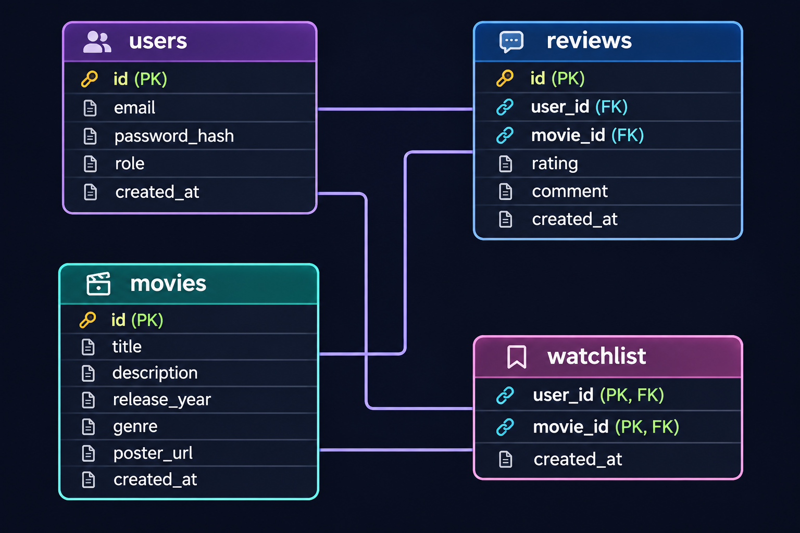

# FilmRecension

## About the Project

FilmRecension is a web application where users can browse movies, write reviews, rate movies and save movies to a personal watchlist.

The project consists of a REST API, a MySQL database and a frontend built with HTML, CSS and JavaScript.

## Features

- Register a user account.
- Log in and log out.
- Browse movies and view movie details.
- Read movie reviews.
- Create and edit personal reviews.
- Rate movies from 1 to 10.
- Add and remove movies from a personal watchlist.

## Technologies

- Node.js
- Express
- MySQL
- Docker and Docker Compose
- JWT
- bcrypt
- HTML, CSS and JavaScript

## Installation

### Prerequisites

- Docker Desktop for Windows or macOS.
- Docker Compose (included with Docker Desktop).

Download Docker Desktop from:
https://www.docker.com/products/docker-desktop/

Make sure Docker Desktop is running before starting the application.

### 1. Download the project

Download and extract the project from GitHub.

Open the project folder in VS Code or in your terminal.

### 2. Configure environment variables

Create a `.env` file by copying the provided `.env.example` file.

**Windows (PowerShell):**

```powershell
Copy-Item .env.example .env
```

**macOS (Terminal):**

```bash
cp .env.example .env
```

Open the newly created `.env` file and replace the example passwords and JWT secret with your own values.

Keep the database host, username, database name and port unchanged.

The `.env` file contains sensitive information and should never be shared or committed to GitHub.

### 3. Start the application

Run the following command from the project folder. This command works on both Windows and macOS.

```bash
docker compose up -d --build
```

Docker Compose will build the backend and start the MySQL database.

The database tables and four initial movies are automatically created when the database is initialized for the first time.

### 4. Open the application

Open the following address in your browser:

http://localhost:3000

You can now register an account, log in, browse movies, write reviews and manage your personal watchlist.

### 5. Check the running containers

```bash
docker compose ps
```

### 6. Stop the application

```bash
docker compose down
```

The database is stored in a persistent Docker volume, which means that users, reviews and saved movies are preserved when the application is stopped.

### Troubleshooting

If the application does not start correctly, check the container logs:

```bash
docker compose logs backend
```

Make sure Docker Desktop is running and that the `.env` file contains the correct environment variables.

If you are using an existing database volume, the database password must match the password used when the database was originally initialized.

5. Open the application in your browser:

http://localhost:3000

The database and four initial movies are automatically created when the database is initialized for the first time.

To stop the application:

```bash
docker compose down
```

## API Endpoints

| Method | Endpoint | Description |
|---|---|---|
| POST | /api/auth/register | Register a user |
| POST | /api/auth/login | Log in |
| GET | /api/movies | Get all movies |
| GET | /api/movies/:id | Get a specific movie |
| GET | /api/movies/:id/reviews | Get movie reviews |
| POST | /api/movies/:id/reviews | Create a review |
| PUT | /api/reviews/:id | Edit your own review |
| GET | /api/watchlist | Get personal watchlist |
| POST | /api/watchlist | Add a movie to watchlist |
| DELETE | /api/watchlist/:movieId | Remove a movie from watchlist |

## Database

The project uses MySQL and contains four database tables:

- **users:** Stores user account information and hashed passwords.
- **movies:** Stores movie information.
- **reviews:** Stores user reviews and ratings.
- **watchlist:** Stores movies saved by users.

### ER Diagram



The reviews and watchlist tables are connected to the users and movies tables through foreign keys.

- **PK (Primary Key):** Uniquely identifies a record in a table.
- **FK (Foreign Key):** Creates a connection between tables.

The watchlist table uses a composite primary key to prevent users from saving the same movie more than once.

## Security

- Passwords are hashed using bcrypt.
- JWT is used for authentication.
- Protected endpoints require authentication.
- Users can only edit their own reviews.
- Each user has a personal watchlist.
- Parameterized SQL queries are used to help prevent SQL injection.
- Sensitive information is stored in environment variables.

## Testing

The REST API and frontend have been tested manually. Registration, login, movie browsing, reviews and watchlist functionality have been tested.

The application has also been tested using two different user accounts.

## Project Purpose

The purpose of this project is to develop a functional REST API with a database, user authentication and a frontend that allows users to interact with the application.